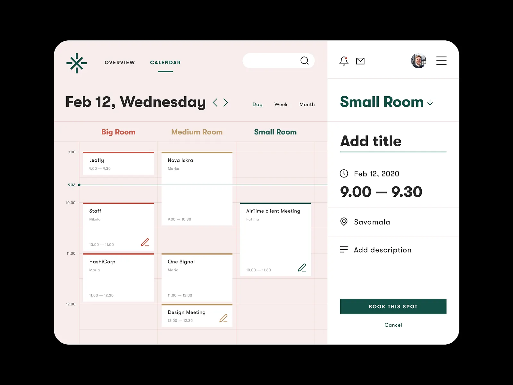
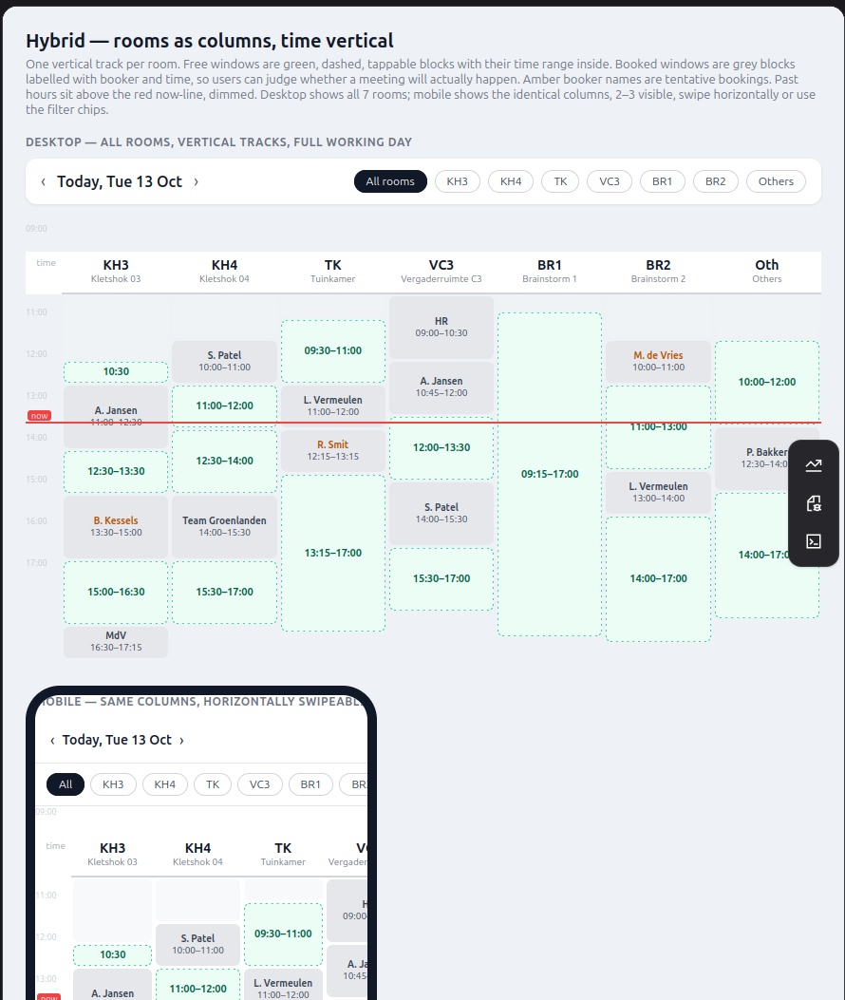
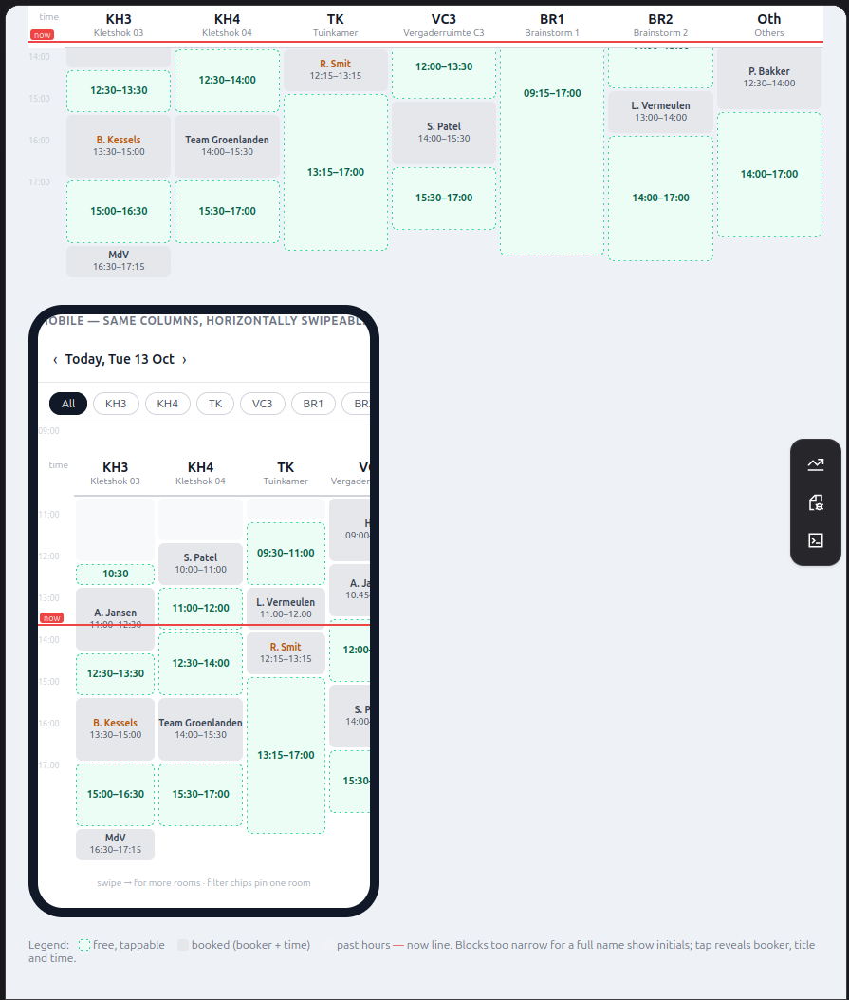

# Support both room-first and time-first booking through a hybrid overview dashboard

|           |                          |
| --------- | ------------------------ |
| Status    | accepted                 |
| Date      | 2026-10-19               |
| Deciders  | berkes                   |
| Consulted | Vibe Code agent          |
| Informed  | boekjehokje contributors |

## Context and Problem Statement

boekjehokje manages meeting rooms ("hokjes") in the NYMA Makersplaats through a
shared Google Calendar. Users arrive with one of two needs: either they have a
specific room in mind ("C3", "stilteruimte") and want to know when it is free,
or they have a time in mind and want any suitable room — notably the
interchangeable "Kletshokken". Google Calendar itself gives no structured
overview of room availability, which makes finding a free room or a free slot
cumbersome and error-prone.

This ADR was derived from older project documentation (`docs/workflow.md`),
which it replaces. Which booking workflow should the app offer?

## Decision Drivers

- The app must be easier to use than Google Calendar directly, and guide users
  visually without strict rule enforcement.
- Both specific rooms and interchangeable, grouped rooms ("Kletshokken") must be
  supported.
- Users stay free to book directly in the underlying Google Calendar; the app
  guides but does not enforce.
- The UI is Dutch, built with MUI and the DayPilot Lite resource calendar (rooms
  as columns, time as rows).
- Pure frontend: Google Calendar is the single source of truth for events.

## Considered Options

- Room-first booking only
- Time-first booking only
- Hybrid: an overview dashboard offering both room-first and time-first booking

## Decision Outcome

Chosen option: **Hybrid — an overview dashboard offering both room-first and
time-first booking**, because it is the only option that serves both user needs
without forcing users into a mental model they do not have. Users with a room in
mind can pick the room and then a free slot; users with a time in mind can pick
the slot and then any available room.

The dashboard shows all rooms (specific rooms such as "C3" and "stilteruimte"
are visually distinguished; "Kletshokken" are grouped as generic,
interchangeable rooms) in a calendar view with booked slots marked and available
slots clearly highlighted. Both entry points lead to the same booking
confirmation, where users enter their name and contact information (if not
already provided), review the details, and confirm. The app then creates an
event in Google Calendar in the standardized format.

For "Kletshokken", the app can suggest the least-used available room for the
selected time slot, and users can switch rooms or slots if their preferred
option is unavailable.

The concrete shape of the dashboard is captured in the interactive mockup
described under [Design References and Mockups](#design-references-and-mockups).

### Consequences

- Good, because users get a complete view of all rooms and their availability,
  making it easy to find a suitable slot.
- Good, because users can start from whichever they care about — room or time —
  depending on their need.
- Good, because visual cues and suggestions guide users toward available slots
  or rooms without enforcing rules.
- Bad, because the dashboard must render many rooms and time slots at once; the
  calendar view needs attention to performance (e.g., lazy loading) if the
  number of events grows.
- Bad, because supporting two booking paths is more UI complexity than a
  single-path flow.

## Design References and Mockups

The hybrid workflow was explored visually before it was decided. All references
live in
[`assets/0002-hybrid-booking-workflow/`](assets/0002-hybrid-booking-workflow/)
(next to this ADR).

### Sketch and screenshots

**`inspiration.webp`** — photograph of a hand-drawn sketch exploring how the
room overview could be laid out: the earliest exploration of putting rooms and
time on a single screen.

**`inspiration1.png`** — screenshot of an existing app, collected as visual
inspiration for how a booking overview can present rooms and their availability.

**`inspiration2.png`** — second screenshot used as visual inspiration for the
same purpose.

### Interactive mockup

[`hybrid-rooms-as-columns-vertical-time-axis-desktop-and-mobile.html`](assets/0002-hybrid-booking-workflow/hybrid-rooms-as-columns-vertical-time-axis-desktop-and-mobile.html)
is a self-contained static mockup of the chosen layout ("Hybrid — rooms as
columns, vertical time axis"). Open it directly in a browser; it needs no build
or server. It shows:

- One vertical track per room — seven example rooms (KH3, KH4, TK, VC3, BR1,
  BR2, "Others") — on a time axis covering the working day (09:00–17:15).
- Free windows as green, dashed, tappable blocks with their time range inside:
  the room-first entry point.
- Booked windows as grey blocks labelled with booker and time, so users can
  judge whether a meeting will actually happen; tentative bookings show the
  booker name in amber.
- Past hours dimmed above a red "now" line, and day navigation arrows.
- A desktop board showing all rooms side by side, and a mobile view showing the
  identical columns in a horizontally swipeable viewport (two to three rooms
  visible), with filter chips to pin a specific room.
- Narrow blocks showing initials; tapping reveals booker, title and time.

The mockup demonstrates how the hybrid dashboard fits both the room-first flow
(tap a room's track, then a free block) and the time-first flow (scan a time
band across all room tracks, then pick a free block), on both desktop and
mobile.

Note: the room names in the mockup (KH3, KH4, TK, VC3, BR1, BR2) are examples
from when the mockup was drawn and differ from the room names used elsewhere in
this ADR ("C3", "stilteruimte", "Kletshokken").

## Validation

The Playwright E2E suite (ADR-0001) covers this decision with
`dashboard.spec.ts` (overview dashboard shows rooms and availability),
`room-first.spec.ts` (room → availability → book slot) and `time-first.spec.ts`
(time slot → available rooms → book).

## Pros and Cons of the Options

### Room-first booking only

Users click a specific room to see its detailed availability, then select a free
slot.

- Good, because the simplest flow to implement and explain.
- Good, because it fits users who always want a particular room.
- Bad, because it ignores users who have a time in mind and want any available
  room, which is the common case for the interchangeable "Kletshokken".
- Bad, because it offers no overview across rooms, so finding "any free room at
  14:00" means checking rooms one by one.

### Time-first booking only

Users click a time slot in the calendar to see which rooms are available at that
time, then select a room.

- Good, because it directly answers "what is free right now / at this time?".
- Bad, because it ignores users who want a particular room and are flexible
  about time.
- Bad, because it hides per-room history and patterns (e.g., "C3 is always free
  in the morning").

### Hybrid: an overview dashboard with both entry points

One dashboard with an interactive calendar of all rooms; clicking a room gives
its availability (room-first), clicking a slot gives the rooms free at that time
(time-first).

- Good, because it serves both user needs with one screen.
- Good, because visual cues and suggestions (e.g., least-used Kletshokje) guide
  users toward available options.
- Good, because users can switch rooms or slots when their preferred option is
  unavailable.
- Bad, because more UI complexity and more rendering work than a single-path
  flow; requires the calendar component to handle multiple rooms efficiently and
  stay responsive on desktop and mobile.

## More Information

- This ADR was derived from the old documentation `docs/workflow.md`, which has
  been removed from the repository.
- Events are created in Google Calendar in a standardized format; see
  [ADR-0003](0003-pure-frontend-tech-stack.md) for the stack that implements
  this workflow.
