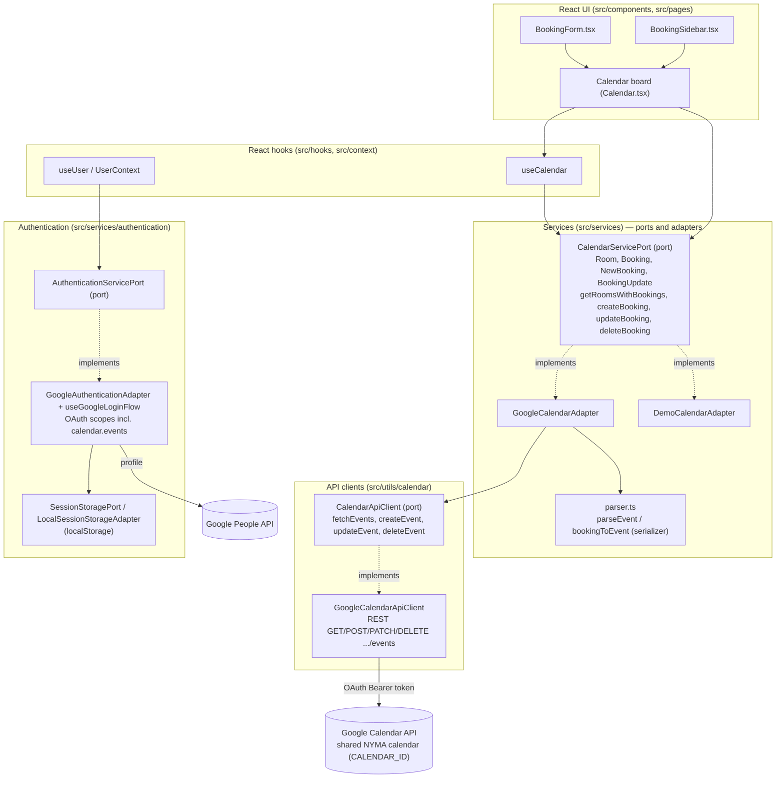

# Architecture: the app and the Google Calendar API

High-level overview of how boekjehokje talks to Google Calendar. The app is a
pure frontend (ADR-0003): Google Calendar is the single source of truth, and
every interaction with it goes through a port/adapter pair, so no Google shapes
leak into the UI or the domain services.

The diagrams below are [Mermaid](https://mermaid.js.org/) — plain Markdown code
blocks that GitHub renders natively and that stay trivially editable as text.
They are deliberately high level, at module level: components, hooks, services,
adapters and ports, not classes and functions.

Layers, top to bottom:

- **React UI** (`src/components/`, `src/pages/`) — MUI components and the
  super-calendar board. No API calls, only domain types from the services.
- **React hooks** (`src/hooks/`, `src/context/`) — `useCalendar` loads rooms
  through the calendar service port; `useUser` exposes the authentication
  session.
- **Services** (`src/services/`) — the ports (`CalendarServicePort`,
  `AuthenticationServicePort`) define the domain language (`Room`, `Booking`,
  `NewBooking`, `BookingUpdate`, create/update/delete operations);
  `GoogleCalendarAdapter` and `DemoCalendarAdapter` implement the calendar port;
  `parser.ts` holds both directions of the standardized event format
  (`parseEvent` reads, `bookingToEvent` writes).
- **Adapters/clients** (`src/utils/calendar/`) — `CalendarApiClient` is the
  injected port; `GoogleCalendarApiClient` implements it with the REST calls
  (`GET/POST/PATCH/DELETE .../calendars/{id}/events`) against `CALENDAR_ID`.
- **Authentication** (`src/services/authentication/`) —
  `GoogleAuthenticationAdapter` owns the OAuth flow and scopes (including
  `calendar.events`, which grants the event writes) and the People API; the
  session persists through `SessionStoragePort` in localStorage.

## Component diagram



## Sequence: how events get on screen

```mermaid
sequenceDiagram
  actor User
  participant Board as Calendar board (Calendar.tsx)
  participant Hook as useCalendar (hook)
  participant Service as CalendarServicePort
  participant Adapter as GoogleCalendarAdapter
  participant Parser as parser.ts
  participant Client as CalendarApiClient
  participant GClient as GoogleCalendarApiClient
  participant API as Google Calendar API

  User->>Board: open the week overview
  Board->>Hook: load()
  Hook->>Service: getRoomsWithBookings(week)
  Service->>Adapter: getRoomsWithBookings(week)
  Adapter->>Client: fetchEvents(CALENDAR_ID, week.start, week.end)
  Client->>GClient: fetchEvents(...)
  GClient->>API: GET /calendars/&lt;id&gt;/events?timeMin=...&amp;timeMax=...
  API-->>GClient: events (JSON)
  GClient-->>Adapter: CalendarEvent[]
  Adapter->>Parser: parseAndGroupEvents(events)
  Parser-->>Adapter: room groups (room + booker from the summary)
  Adapter-->>Service: Room[] with editable flags (ADR-0004)
  Service-->>Hook: rooms
  Hook-->>Board: rooms state
  Board-->>User: render room columns, bookings and free slots
```

## Sequence: how a booking is created

```mermaid
sequenceDiagram
  actor User
  participant Form as BookingForm
  participant Board as CalendarView (Calendar.tsx)
  participant Service as CalendarServicePort
  participant Adapter as GoogleCalendarAdapter
  participant Parser as parser.ts (bookingToEvent)
  participant Client as CalendarApiClient
  participant GClient as GoogleCalendarApiClient
  participant API as Google Calendar API

  User->>Form: pick a slot, fill in contact, confirm
  Form->>Board: onSubmit(NewBooking)
  Board->>Service: createBooking(NewBooking)
  Service->>Adapter: createBooking(booking)
  Adapter->>Parser: bookingToEvent(booking)
  Parser-->>Adapter: CalendarEventDraft (summary "KH 03 | Bèr", description = contact)
  Adapter->>Client: createEvent(CALENDAR_ID, draft)
  Client->>GClient: createEvent(...)
  GClient->>API: POST /calendars/&lt;id&gt;/events
  API-->>GClient: created event
  GClient-->>Adapter: CalendarEvent
  Adapter->>Parser: parseEvent(event) — round-trip back to domain
  Parser-->>Adapter: Booking
  Adapter-->>Board: created Booking
  Board->>Service: getRoomsWithBookings() (refresh board)
  Service-->>Board: updated rooms
  Board-->>User: board shows the new booking
```

## Sequence: how a booking is updated or deleted

Update and delete share the whole write path and differ only in the verb and the
service method, so they are folded into one diagram. The edit UI (the same
booking form, prefilled) and the delete icon are wired in issue #14's PR; the
timed undo toast is issue #36.

```mermaid
sequenceDiagram
  actor User
  participant UI as Edit form / delete icon (board actions)
  participant Service as CalendarServicePort
  participant Adapter as GoogleCalendarAdapter
  participant Parser as parser.ts (bookingToEvent)
  participant Client as CalendarApiClient
  participant GClient as GoogleCalendarApiClient
  participant API as Google Calendar API

  User->>UI: change or delete an own booking (ADR-0004)
  alt update
    UI->>Service: updateBooking(BookingUpdate with id)
    Service->>Adapter: updateBooking(booking)
    Adapter->>Parser: bookingToEvent(booking)
    Parser-->>Adapter: CalendarEventDraft
    Adapter->>Client: updateEvent(CALENDAR_ID, id, draft)
    Client->>GClient: updateEvent(...)
    GClient->>API: PATCH /calendars/&lt;id&gt;/events/&lt;eventId&gt;
    API-->>GClient: updated event
    GClient-->>Adapter: CalendarEvent (parsed back to Booking)
  else delete
    UI->>Service: deleteBooking(bookingId)
    Service->>Adapter: deleteBooking(id)
    Adapter->>Client: deleteEvent(CALENDAR_ID, id)
    Client->>GClient: deleteEvent(...)
    GClient->>API: DELETE /calendars/&lt;id&gt;/events/&lt;eventId&gt;
    API-->>GClient: 204 No Content
  end
  Service-->>UI: Booking (update) or void (delete)
  UI->>Service: getRoomsWithBookings() (refresh board)
  Service-->>UI: updated rooms
```

## The standardized event format

Writes and reads meet in one format, defined by `src/services/parser.ts`:

- **summary**: `<room short name> | <booker>`, e.g. `KH 03 | Bèr` —
  `bookingToEvent` (serializer) produces it, `parseEvent` reads the room and
  booker back out of it; the round-trip is unit tested.
- **description**: the booker's contact details (optional).
- **start / end**: RFC 3339 `dateTime`.

Events created outside the app (directly in Google Calendar) are parsed by the
same `parseEvent`, so both flows land in the same domain model.
