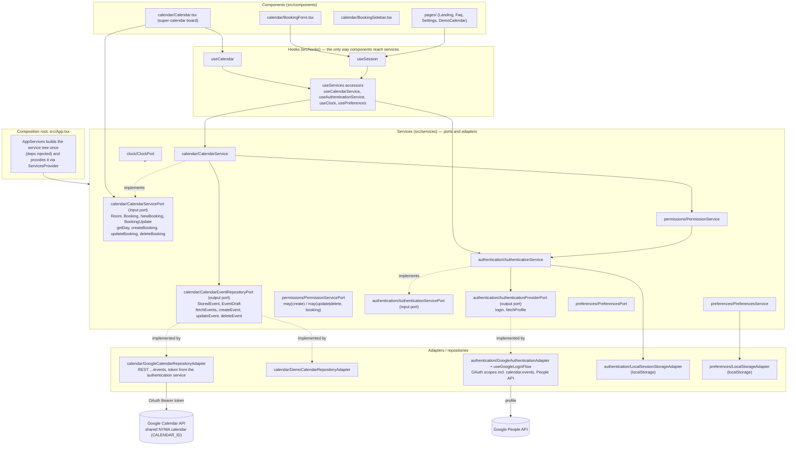

# Architecture: components, hooks, services, ports and adapters

High-level overview of how boekjehokje is structured and how it talks to Google
Calendar. The app is a pure frontend (ADR-0003): Google Calendar is the single
source of truth, and every interaction with it goes through a repository adapter
behind a port, so no Google shapes leak into the services or the UI.

The structure is decided in
[ADR-0007](adr/0007-components-services-ports-adapters.md) (testing in
[ADR-0008](adr/0008-testing-strategy-services.md)): the app has only components,
hooks, services, ports and adapters. The diagrams below are
[Mermaid](https://mermaid.js.org/) — plain Markdown code blocks that GitHub
renders natively and that stay trivially editable as text. They are deliberately
high level, at module level.

Layers, top to bottom:

- **Components** (`src/components/`) — MUI components, the pages
  (`components/pages/`) and the super-calendar board (`components/calendar/`).
  No API calls, no service wiring: domain types and pure helpers from the
  services barrel, service instances only via hooks.
- **Hooks** (`src/hooks/`) — the React bridge. `ServicesProvider` provides the
  service tree; `useServices.ts` exposes typed accessors; `useSession`,
  `useCalendar` and `useRoomVisibility` call the services and manage the results
  as React state.
- **Services** (`src/services/<name>/`) — each service is an object with methods
  implementing its input port, with all dependencies injected on creation:
  **authentication** (`AuthenticationService` over an
  `AuthenticationProviderPort` + `SessionStoragePort`), **permissions**
  (`PermissionService`, deciding editability per ADR-0004, reading the current
  user from the authentication service), **calendar** (`CalendarService` over a
  `CalendarEventRepositoryPort` + the permission service + the clock), **clock**
  (`SystemClock`), **preferences** (`PreferencesService` over a
  `KeyValueStorePort`).
- **Adapters / repositories** — inside the service modules:
  `GoogleCalendarRepositoryAdapter` (REST GET/POST/PATCH/DELETE
  `.../calendars/{id}/events` against `CALENDAR_ID`, reading the OAuth token
  from the authentication service per call), `DemoCalendarRepositoryAdapter`,
  `GoogleAuthenticationAdapter` (OAuth flow + People API),
  `LocalSessionStorageAdapter` and `LocalStorageAdapter` (localStorage).

The whole service tree is composed once on top level in `App.tsx`
(`AppServices`) and provided through `ServicesProvider`; the demo page composes
a subset tree with the demo repository.

## Component diagram



## Sequence: how events get on screen

```mermaid
sequenceDiagram
  actor User
  participant Board as Calendar board (components/calendar/Calendar.tsx)
  participant Hook as useCalendar (hook)
  participant Service as CalendarService
  participant Permissions as PermissionService
  participant Repo as CalendarEventRepositoryPort
  participant Google as GoogleCalendarRepositoryAdapter
  participant Format as eventFormat service (parse/serialize)
  participant API as Google Calendar API

  User->>Board: open the day overview (today)
  Board->>Hook: load(day)
  Hook->>Service: getDay(day)
  Service->>Repo: fetchEvents(dayRange)
  Repo->>Google: fetchEvents(dayRange)
  Google->>API: GET /calendars/&lt;id&gt;/events?timeMin=...&amp;timeMax=...
  API-->>Google: events (JSON, mapped to StoredEvent)
  Google-->>Service: StoredEvent[]
  Service->>Format: eventFormat.parse(event) per event
  Format-->>Service: parsed events (room + booker from the summary)
  Service->>Permissions: may("update", booking) per booking (ADR-0004)
  Permissions-->>Service: editable flags
  Service-->>Hook: Room[] grouped by room, with editable flags
  Hook-->>Board: rooms state
  Board-->>User: render room columns, bookings and free slots
  User->>Board: switch day (previous/next/today/quick button)
  Board->>Hook: load(newDay)
  Hook->>Service: getDay(newDay) (only the selected day is fetched)
```

## Sequence: how a booking is created

```mermaid
sequenceDiagram
  actor User
  participant Form as BookingForm
  participant Board as CalendarView (components/calendar/Calendar.tsx)
  participant Service as CalendarService
  participant Format as eventFormat service
  participant Repo as CalendarEventRepositoryPort
  participant Google as GoogleCalendarRepositoryAdapter
  participant API as Google Calendar API

  User->>Form: pick a slot, fill in contact, confirm
  Form->>Board: onSubmit(NewBooking)
  Board->>Service: createBooking(NewBooking)
  Service->>Format: eventFormat.serialize(booking)
  Format-->>Service: EventDraft (summary "03 KH | Bèr", description = contact)
  Service->>Repo: createEvent(draft)
  Repo->>Google: createEvent(draft)
  Google->>API: POST /calendars/&lt;id&gt;/events
  API-->>Google: created event (mapped to StoredEvent)
  Google-->>Service: StoredEvent
  Service-->>Board: created Booking (parsed back to domain language)
  Board->>Service: getDay(selectedDay) (refresh board)
  Service-->>Board: updated rooms
  Board-->>User: board shows the new booking
```

## Sequence: how a booking is updated or deleted

Update and delete share the whole write path and differ only in the verb and the
service method, so they are folded into one diagram.

```mermaid
sequenceDiagram
  actor User
  participant UI as Edit form / delete icon (board actions)
  participant Service as CalendarService
  participant Repo as CalendarEventRepositoryPort
  participant Google as GoogleCalendarRepositoryAdapter
  participant API as Google Calendar API

  User->>UI: change or delete an own booking (ADR-0004)
  alt update
    UI->>Service: updateBooking(BookingUpdate with id)
    Service->>Repo: updateEvent(id, bookingToEvent(fields))
    Repo->>Google: updateEvent(id, draft)
    Google->>API: PATCH /calendars/&lt;id&gt;/events/&lt;eventId&gt;
    API-->>Service: updated StoredEvent (parsed back to Booking)
  else delete
    UI->>Service: deleteBooking(bookingId)
    Service->>Repo: deleteEvent(bookingId)
    Repo->>Google: deleteEvent(id)
    Google->>API: DELETE /calendars/&lt;id&gt;/events/&lt;eventId&gt;
    API-->>Google: 204 No Content
  end
  Service-->>UI: Booking (update) or void (delete)
  UI->>Service: getDay(selectedDay) (refresh board)
  Service-->>UI: updated rooms
```

## The standardized event format

Writes and reads meet in one format, owned by the event format service
(`src/services/eventformat/`): `EventFormatService.serialize` writes it,
`EventFormatService.parse` reads it:

- **summary**: `<room short name> | <booker>`, e.g. `03 KH | Bèr` — `serialize`
  produces it, `parse` reads the room and booker back out of it; the round-trip
  is unit tested.
- **description**: the booker's contact details (optional).
- **start / end**: plain `Date`s in the repository port's `EventDraft` /
  `StoredEvent`; only `GoogleCalendarRepositoryAdapter` translates them to and
  from RFC 3339 `dateTime`.

Events created outside the app (directly in Google Calendar) are parsed by the
same `parse`, so both flows land in the same domain model.

## Testing

See [ADR-0008](adr/0008-testing-strategy-services.md): all tests and test-utils
live under `tests/` — unit tests in `tests/unit/` mirroring the src path and
injecting fakes from the central `tests/utils/` kit, integration tests in
`tests/integration/` testing exactly two real services together, and the
Playwright suite in `tests/e2e/` covering the full tree against the
WireMock-mocked Google APIs (see [docs/e2e.md](e2e.md)).
